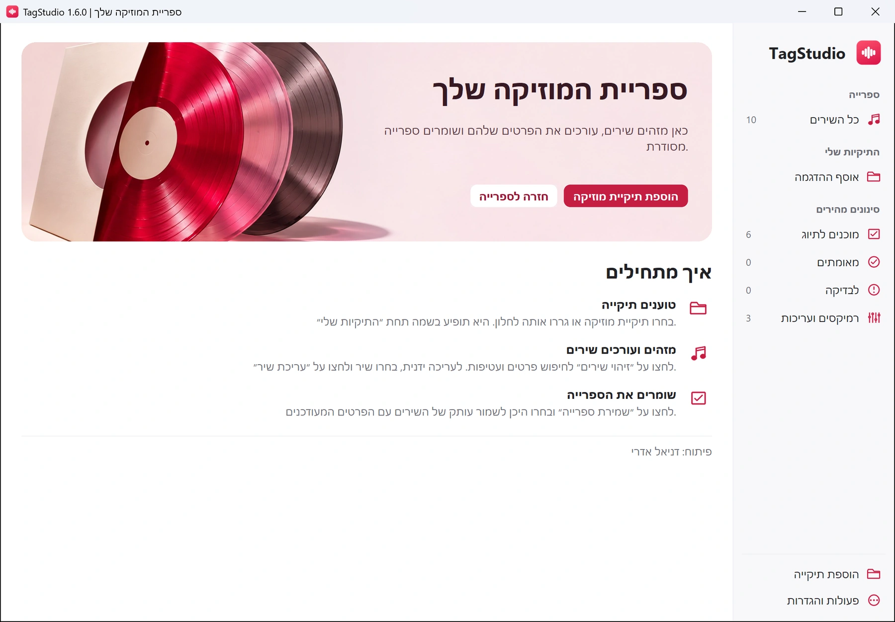

  

<h1 align="center">TagStudio</h1>

ספריית מוזיקה ל־Windows בעברית. זהו שירים ורמיקסים, ערכו את הפרטים והעטיפות ושמרו עותק מעודכן של תיקיות המוזיקה שלכם.

  <a href="https://danieledry2025.github.io/TagStudio-Releases/"><strong>עמוד התוכנה והוראות ההתקנה</strong></a>
  &nbsp;·&nbsp;
  <a href="https://github.com/danieledry2025/TagStudio-Releases/releases/latest/download/TagStudio-Setup-x64.exe"><strong>הורדת המתקין ל־Windows</strong></a>

גרסה 1.6.0 · Windows של 64 ביט · פיתוח דניאל אדרי

  

## התחלה מהירה

1. הורידו ופתחו את המתקין במחשב Windows של 64 ביט.
2. הוסיפו תיקיית מוזיקה או גררו אותה לחלון. בחרו **זיהוי שירים** לחיפוש פרטים ועטיפות.
3. בחרו שיר ולחצו **עריכת שיר** לשינוי פרטים או לבחירת תמונה מהמחשב.
4. לחצו **שמירת ספרייה**, בדקו אילו תיקיות נכללו ובחרו היכן לשמור את העותק המעודכן.

[כל הגרסאות והחידושים](https://github.com/danieledry2025/TagStudio-Releases/releases)
